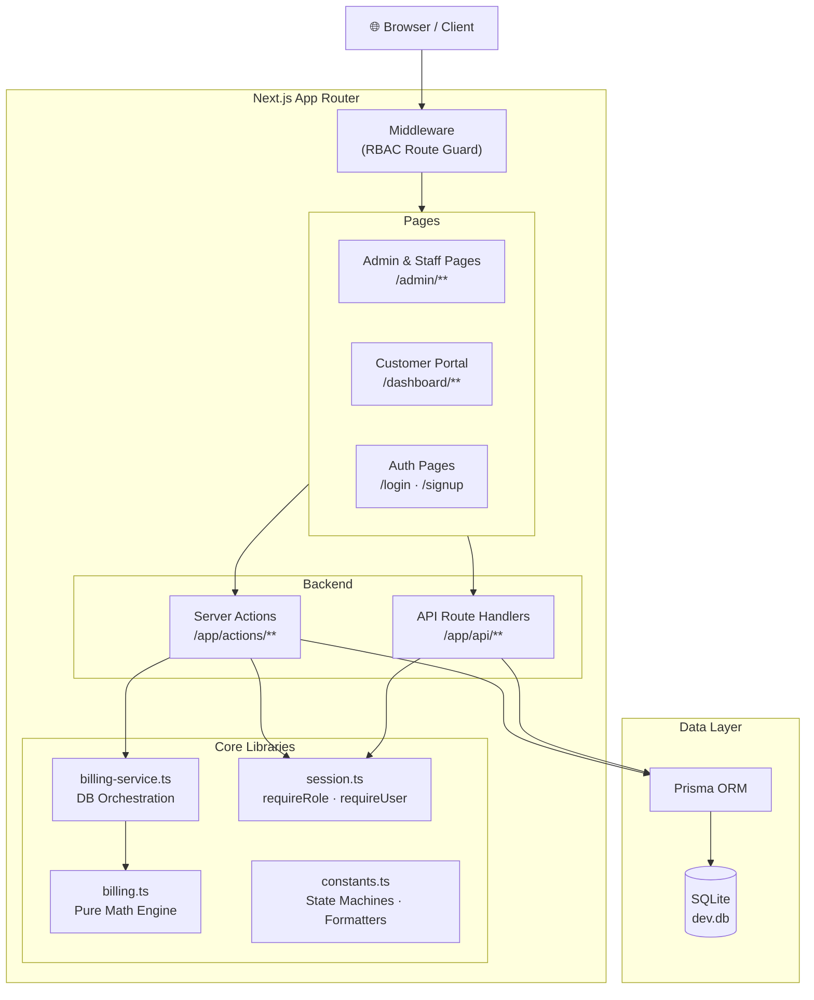
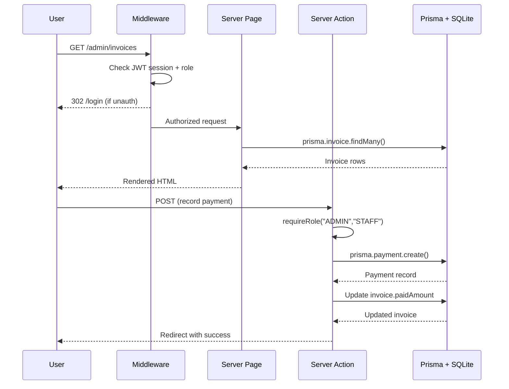
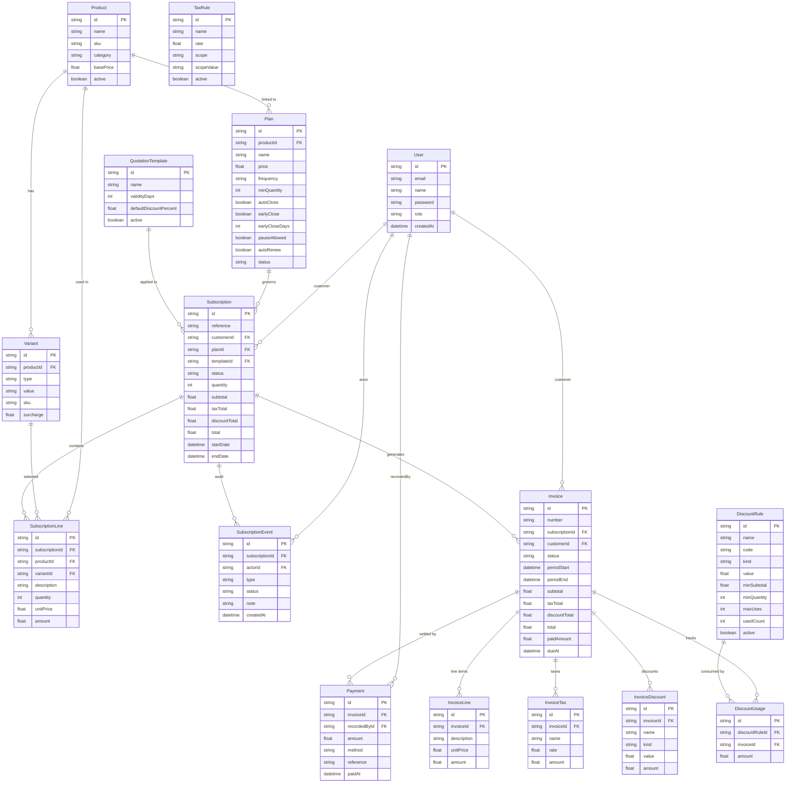
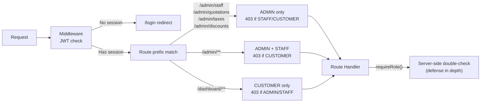

<div align="center">

# ⚡ Brightloop

### Subscription Management & Billing OS

[](https://nextjs.org)
[](https://typescriptlang.org)
[](https://prisma.io)
[](https://tailwindcss.com)
[](https://authjs.dev)
[](https://sqlite.org)
[](LICENSE)

**A complete, production-grade recurring subscription lifecycle, billing engine, invoice management, and financial analytics platform.**

*Built for the OdooXFlux Hackathon 2026*

</div>

---

## 📋 Table of Contents

1. [Problem Statement](#-problem-statement)
2. [Solution Overview](#-solution-overview)
3. [Key Features](#-key-features)
4. [Roles & Permissions](#-roles--permissions)
5. [Subscription Lifecycle](#-subscription-lifecycle)
6. [Technology Stack](#-technology-stack)
7. [System Architecture](#-system-architecture)
8. [Database Schema](#-database-schema)
9. [Quick Start](#-quick-start)
10. [Environment Variables](#-environment-variables)
11. [Project Structure](#-project-structure)
12. [Application Modules & API Routes](#-application-modules--api-routes)
13. [Billing Engine](#-billing-engine)
14. [Dashboard Analytics](#-dashboard-analytics)
15. [Security](#-security)
16. [Automated Testing](#-automated-testing)
17. [Screenshots](#-screenshots)
18. [Deployment](#-deployment)
19. [Future Enhancements](#-future-enhancements)
20. [Team](#-team)

---

## 🎯 Problem Statement

> **Hackathon Theme:** Subscription Management System

Modern SaaS and subscription businesses face a fragmented operational challenge:

- **Manually managed subscriptions** across spreadsheets and disconnected tools
- **No automated billing lifecycle** — renewals, pauses, and closures handled ad-hoc
- **Inaccurate financial reporting** — revenue, outstanding receivables, and overdue invoices not tracked in real time
- **No customer self-service** — customers cannot view their own subscriptions, invoices, or make payments online
- **Security gaps** — no role-based access control separating admin, operations staff, and customers

---

## 💡 Solution Overview

**Brightloop** is a full-stack SaaS subscription management platform that handles the **complete subscription lifecycle** from product catalog through to financial settlement, with role-isolated dashboards for every stakeholder.

```
Admin → Product → Plan → Customer → Quotation → Subscription → Invoice → Payment → Analytics
```

Built as a Next.js 15 App Router monorepo — no separate backend service required. All data operations use **server actions** and **API route handlers** backed by Prisma ORM and SQLite.

---

## ✨ Key Features

| Category | Capability |
|---|---|
| **Product Catalog** | Products with SKU, categories, and typed variants (BRAND, SIZE, COLOR, PACK, FLAVOR) with price surcharges |
| **Subscription Plans** | Configurable billing frequencies (DAILY, WEEKLY, MONTHLY, YEARLY) with 4 lifecycle flags |
| **Subscription Lifecycle** | 5-state machine (DRAFT → QUOTATION → CONFIRMED → ACTIVE → CLOSED) with immutable audit trail |
| **Billing Engine** | Pure math engine for subtotals, scope-based taxes, conditional discounts, and decimal-safe rounding |
| **Idempotent Invoicing** | Unique constraint on `(subscriptionId, periodStart, periodEnd)` — batch runs never double-bill |
| **Partial Payments** | Multi-method payment recording with live balance tracking (OUTSTANDING → PARTIAL → PAID → OVERDUE) |
| **Discount Rules** | FIXED/PERCENT discounts with promo codes, usage limits, validity windows, and scope targeting |
| **Tax Rules** | Auto-applied tax rates scoped to ALL, CATEGORY, or specific PRODUCT |
| **Finance Dashboard** | Real-time KPIs, revenue trends, payment distribution charts, overdue collection ledger |
| **Customer Portal** | Isolated self-service: view subscriptions, catalog checkout with promo codes, pay invoices online |
| **Role-Based Access** | Middleware-enforced RBAC: ADMIN / STAFF / CUSTOMER with route-level isolation |
| **Audit Trail** | `SubscriptionEvent` log captures every state transition, actor, and timestamp |

---

## 👥 Roles & Permissions

### 1-Click Demo Login

The `/login` page includes **1-Click Demo Buttons** to autofill credentials for any role instantly.

| Role | Email | Password | Access |
|---|---|---|---|
| **ADMIN** | `admin@brightloop.com` | `Admin@123` | Full system — staff creation, all CRUD, finance, quotations, taxes, discounts |
| **STAFF** | `staff1@brightloop.com` | `Staff@123` | Operational — subscriptions, invoicing, payment recording, finance ledger |
| **STAFF** | `staff2@brightloop.com` | `Staff@123` | Same as Staff 1 |
| **CUSTOMER** | `customer1@brightloop.com` | `Customer@123` | Isolated portal — own subscriptions, invoices, catalog self-service |
| **CUSTOMER** | `customer2@brightloop.com` | `Customer@123` | Isolated portal |

> **Password Policy:** Minimum 8 characters, at least 1 uppercase, 1 lowercase, 1 special character.

### Role Permission Matrix

| Feature | ADMIN | STAFF | CUSTOMER |
|---|:---:|:---:|:---:|
| Products & Variants | ✅ Full | 👁 Read | ❌ |
| Plans | ✅ Full | 👁 Read | 👁 Catalog |
| Quotation Templates | ✅ Full | ❌ | ❌ |
| Tax & Discount Rules | ✅ Full | ❌ | ❌ |
| Staff Management | ✅ Full | ❌ | ❌ |
| Subscriptions | ✅ Full | ✅ Full | 👁 Own only |
| Invoices & Payments | ✅ Full | ✅ Full | 👁 Own only |
| Finance Dashboard | ✅ | ✅ | ❌ |
| Customer Portal | ❌ | ❌ | ✅ Own data |
| Self-Service Checkout | ❌ | ❌ | ✅ |

---

## 🔄 Subscription Lifecycle

```
DRAFT ──▶ QUOTATION ──▶ CONFIRMED ──▶ ACTIVE ──▶ CLOSED
  ▲            │              │
  └────────────┘◀─────────────┘
       (revert allowed)
```

### States

| State | Description |
|---|---|
| `DRAFT` | Initial creation — editable, no billing, not yet presented |
| `QUOTATION` | Presented to customer — validity window set, totals snapshot computed |
| `CONFIRMED` | Customer has accepted — ready for activation |
| `ACTIVE` | Billing is live — invoices generated per billing period |
| `CLOSED` | Terminated — no further billing |

### Lifecycle Controls (gated by Plan flags)

| Action | Condition |
|---|---|
| **Pause** | `plan.pauseAllowed = true` and subscription is ACTIVE |
| **Resume** | Subscription is currently paused |
| **Early Close** | `plan.earlyClose = true` and within `earlyCloseDays` window |
| **Auto Renew** | `plan.autoRenew = true` — extends period on expiry |
| **Auto Close** | `plan.autoClose = true` — closes automatically at `endDate` |

Every transition is captured in `SubscriptionEvent` with actor identity, timestamp, and optional note.

---

## 🛠 Technology Stack

| Layer | Technology | Version |
|---|---|---|
| **Framework** | Next.js (App Router) | 15.x |
| **Language** | TypeScript | 5.9 |
| **UI Library** | React | 19.x |
| **Styling** | Tailwind CSS + tailwindcss-animate | 3.4 |
| **UI Components** | Radix UI primitives (Dialog, Label, Slot) | Latest |
| **Icons** | Lucide React | 1.65 |
| **ORM** | Prisma | 6.x |
| **Database** | SQLite (via Prisma, dev) | 3 |
| **Authentication** | NextAuth.js / Auth.js v5 beta | 5.0.0-beta.32 |
| **Password Hashing** | bcryptjs | 3.x |
| **Validation** | Zod | 3.x |
| **Utilities** | clsx, tailwind-merge, class-variance-authority | Latest |
| **Test Runner** | tsx (inline E2E script) | 4.x |

---

## 🏗 System Architecture



### Request Flow



---

## 🗄 Database Schema

### Entity-Relationship Diagram



### Key Constraints

| Model | Unique Constraint | Purpose |
|---|---|---|
| `User` | `email` | Prevent duplicate accounts |
| `Product` | `sku` | Unique product identifier |
| `Variant` | `sku` | Unique variant identifier |
| `DiscountRule` | `code` | Unique promo code |
| `Invoice` | `number` | Unique invoice number |
| `Invoice` | `(subscriptionId, periodStart, periodEnd)` | **Idempotency** — prevents double-billing |

---

## 🚀 Quick Start

### Prerequisites

- **Node.js** 18+ (Node.js 20+ recommended)
- **npm** (bundled with Node.js)
- **Git**

### 1. Clone the Repository

```bash
git clone https://github.com/jayz20083147/OdooXflux_hackathon.git
cd OdooXflux_hackathon
```

### 2. Install Dependencies

```bash
npm install
```

### 3. Configure Environment

```bash
cp .env.example .env
# Edit .env — set NEXTAUTH_SECRET to a random string (see Environment Variables below)
```

### 4. Initialize Database

```bash
# Push schema to local SQLite (creates prisma/dev.db)
npx prisma db push

# Seed with realistic demo data
npm run db:seed
```

> **One-Step Reset:** `npm run db:reset` — wipes and re-seeds the database in one command.

### 5. Start Development Server

```bash
npm run dev
```

Open **[http://localhost:3000](http://localhost:3000)** and use the **1-Click Demo Buttons** on the login page.

### Available Scripts

| Script | Command | Description |
|---|---|---|
| Dev server | `npm run dev` | Start Next.js development server |
| Production build | `npm run build` | Compile and optimize for production |
| Start production | `npm run start` | Run the production build |
| DB push | `npm run db:push` | Push Prisma schema to the database |
| DB seed | `npm run db:seed` | Populate database with demo data |
| DB reset | `npm run db:reset` | Force-reset schema and re-seed |
| E2E verify | `npm run verify` | Run the 7-scene automated test suite |

---

## 🔧 Environment Variables

Copy `.env.example` to `.env` and fill in the values:

```env
# Database — SQLite file path (relative to project root)
DATABASE_URL="file:./prisma/dev.db"

# NextAuth.js — required for JWT session signing
# Generate with: openssl rand -base64 32
NEXTAUTH_SECRET="your-secret-here"

# Application URL
NEXTAUTH_URL="http://localhost:3000"
```

> ⚠️ **Never commit `.env` to version control.** It is listed in `.gitignore`.

---

## 📁 Project Structure

```text
brightloop-final/
├── prisma/
│   ├── dev.db                    # Local SQLite database
│   ├── schema.prisma             # Prisma schema (15 models)
│   └── seed.ts                   # Idempotent demo data seeder
├── public/
│   └── logo.svg                  # Application brand icon
├── scripts/
│   ├── verify.ts                 # Sanity / policy tests
│   └── verify_full.ts            # 7-Scene E2E automated test suite
├── src/
│   ├── app/
│   │   ├── (app)/admin/          # Admin & Staff console
│   │   │   ├── page.tsx          # Dual-role executive dashboard
│   │   │   ├── products/         # Products & Variants CRUD
│   │   │   ├── plans/            # Subscription Plans CRUD
│   │   │   ├── quotations/       # Quotation Templates CRUD
│   │   │   ├── subscriptions/    # Subscription management & detail
│   │   │   ├── invoices/         # Invoice ledger, detail, payment recording
│   │   │   ├── taxes/            # Tax Rules CRUD
│   │   │   ├── discounts/        # Discount Rules & Promo Codes
│   │   │   ├── staff/            # Admin-only staff account creation
│   │   │   └── finance/          # Finance ledger dashboard
│   │   ├── (auth)/
│   │   │   ├── login/            # Sign-in with 1-click demo buttons
│   │   │   └── signup/           # Customer registration
│   │   ├── (portal)/dashboard/   # Customer self-service portal
│   │   │   ├── page.tsx          # Customer overview & KPI cards
│   │   │   ├── catalog/          # Self-service plan catalog
│   │   │   ├── invoices/         # Personal invoices & Pay Now
│   │   │   └── subscriptions/    # Customer subscription views
│   │   ├── actions/              # Next.js Server Actions
│   │   ├── api/                  # REST API route handlers
│   │   ├── forbidden/            # 403 page
│   │   └── globals.css           # Tailwind base styles
│   ├── components/
│   │   ├── ui/                   # Radix UI primitives (badge, button, card, table …)
│   │   ├── app-sidebar.tsx       # Admin/Staff navigation sidebar
│   │   ├── app-header.tsx        # Mobile hamburger drawer header
│   │   ├── portal-nav.tsx        # Customer portal navigation
│   │   ├── dashboard-charts.tsx  # Revenue, payment distribution & plan charts
│   │   ├── empty-state.tsx       # Reusable empty state component
│   │   ├── payment-form.tsx      # Payment recording form
│   │   ├── delete-button.tsx     # Confirm-before-delete button
│   │   └── subscription-actions.tsx  # Lifecycle action triggers & badge helpers
│   ├── lib/
│   │   ├── billing.ts            # Pure math billing engine (no DB)
│   │   ├── billing-service.ts    # DB orchestration — idempotent invoice generator
│   │   ├── constants.ts          # State machines, enums, formatters, helpers
│   │   ├── prisma.ts             # Prisma singleton client
│   │   ├── session.ts            # requireUser / requireRole guards
│   │   ├── form.ts               # Form state helpers
│   │   ├── utils.ts              # cn() Tailwind class merge helper
│   │   └── validators.ts         # Zod validation schemas
│   ├── types/
│   │   └── next-auth.d.ts        # NextAuth custom type extensions
│   ├── auth.config.ts            # Edge-safe NextAuth configuration
│   ├── auth.ts                   # Credentials provider with Prisma & bcrypt
│   └── middleware.ts             # RBAC route protection middleware
├── .env.example                  # Environment variables template
├── .gitignore
├── next.config.mjs
├── package.json
├── tailwind.config.ts
└── tsconfig.json
```

---

## 🔌 Application Modules & API Routes

### Server Actions (`src/app/actions/`)

| File | Key Actions | Description |
|---|---|---|
| `auth.ts` | `loginAction`, `registerAction` | Credentials sign-in, customer self-registration |
| `products.ts` | `createProductAction`, `updateProductAction`, `deleteProductAction`, `toggleProductActiveAction` | Product & variant management |
| `plans.ts` | `createPlanAction`, `updatePlanAction`, `deletePlanAction`, `togglePlanStatusAction` | Plan lifecycle management |
| `subscriptions.ts` | `createSubscriptionAction`, `updateSubscriptionStatusAction`, `customerSubscribeAction` | Subscription provisioning & status transitions |
| `invoices.ts` | `generateInvoicesAction`, `invoiceStatusAction`, `recordPaymentAction`, `deleteInvoiceAction` | Invoice generation & payment recording |
| `quotations.ts` | `createQuotationTemplateAction`, `deleteQuotationTemplateAction`, `toggleQuotationTemplateAction` | Quotation template management |
| `taxes.ts` | `createTaxRuleAction`, `updateTaxRuleAction`, `deleteTaxRuleAction` | Tax rule management |
| `discounts.ts` | `createDiscountRuleAction`, `updateDiscountRuleAction`, `deleteDiscountRuleAction` | Discount & promo code management |
| `staff.ts` | `createStaffAction`, `deleteUserAction` | Admin-only staff account management |

### REST API Routes (`src/app/api/`)

| Method | Route | Auth | Description |
|---|---|---|---|
| `POST` | `/api/auth/register` | Public | Customer self-registration |
| `GET` | `/api/products` | ADMIN/STAFF | List all products |
| `POST` | `/api/products` | ADMIN | Create product |
| `GET` | `/api/products/[id]` | ADMIN/STAFF | Get single product |
| `GET` | `/api/plans` | ADMIN/STAFF | List all plans |
| `POST` | `/api/plans` | ADMIN | Create plan |
| `GET` | `/api/plans/[id]` | ADMIN/STAFF | Get single plan |
| `GET` | `/api/subscriptions` | ADMIN/STAFF | List subscriptions |
| `POST` | `/api/subscriptions` | ADMIN/STAFF | Create subscription |
| `GET` | `/api/subscriptions/[id]` | ADMIN/STAFF | Get subscription |
| `GET` | `/api/invoices` | ADMIN/STAFF | List invoices |
| `POST` | `/api/invoices` | ADMIN/STAFF | Generate invoice for subscription period |
| `GET` | `/api/invoices/[id]` | ADMIN/STAFF | Get single invoice |
| `POST` | `/api/payments` | ADMIN/STAFF | Record payment against invoice |
| `GET` | `/api/discounts` | ADMIN/STAFF | List discount rules |
| `GET` | `/api/finance` | ADMIN/STAFF | Finance dashboard metrics |
| `GET` | `/api/users` | ADMIN | List all users |
| `GET` | `/api/users/staff` | ADMIN | List staff/admin accounts |

---

## 💰 Billing Engine

### Calculation Pipeline (`src/lib/billing.ts`)

The billing engine is a **pure function module** — no database access. It receives subscription lines and rules, and returns precise totals.

```
Subscription Lines
       │
       ▼
  [1] Subtotal = Σ (quantity × unitPrice) per line
       │
       ▼
  [2] Discount Engine
       ├── Filter rules: active, within validFrom–validTo window
       ├── Check conditions: minSubtotal, minQuantity, maxUses
       ├── Code-gated rules: only apply when matching promo code provided
       ├── Compute scope base: ALL | CATEGORY | PRODUCT
       └── Apply: PERCENT (%) or FIXED ($) — capped at scope base
       │
       ▼
  [3] Tax Engine
       ├── Filter rules: active
       ├── Compute scope base: ALL | CATEGORY | PRODUCT
       └── Apply rate to net-of-discount scope base
       │
       ▼
  [4] Total = Subtotal − discountTotal + taxTotal
       │
       ▼
  round2() — Math.round(value × 100) / 100
```

### Idempotent Invoice Generation (`src/lib/billing-service.ts`)

```
generateDueInvoices()
    │
    ├── Find all ACTIVE subscriptions where currentPeriodEnd ≤ now
    │
    ├── For each subscription:
    │   ├── Compute period (currentPeriodStart → currentPeriodEnd)
    │   ├── prisma.invoice.upsert (unique: subscriptionId + periodStart + periodEnd)
    │   │   └── Already exists → SKIP (idempotent)
    │   ├── Apply billing.calculateTotals(lines, taxRules, discountRules)
    │   ├── Snapshot InvoiceLines, InvoiceTaxes, InvoiceDiscounts
    │   ├── Track DiscountUsage (increment usedCount)
    │   └── Advance currentPeriodStart/End by one billing frequency
    │
    └── Return { generated, skipped } counts
```

### Invoice Payment States

| State | Condition |
|---|---|
| `OUTSTANDING` | Invoice confirmed, no payments recorded, not yet past due |
| `PARTIAL` | Some payments recorded, balance > $0, not overdue |
| `OVERDUE` | Balance > $0 and current date > `dueAt` |
| `PAID` | `paidAmount >= total` — balance is $0, `paidAt` timestamp set |
| `DRAFT` | Invoice not yet confirmed |
| `CANCELLED` | Invoice voided — discount usage slots released back |

### Payment Methods Supported

`CASH` · `CARD` · `BANK_TRANSFER` · `UPI` · `CHEQUE` · `OTHER`

---

## 📊 Dashboard Analytics

### Admin Executive Dashboard (`/admin`)

**KPI Cards:**
- 💰 **Monthly Recurring Revenue (MRR)** — normalized from all active subscriptions by billing frequency
- 📋 **Active Subscriptions** — count of subscriptions in ACTIVE state
- ✅ **Revenue Collected** — total settled payments (all time)
- ⚠️ **Outstanding Payments** — sum of unpaid invoice balances

**Charts:**
- 📈 **Monthly Revenue Trend** — 12-month bar chart of invoiced amounts
- 🥧 **Payment Status Distribution** — PAID / PARTIAL / OUTSTANDING / OVERDUE breakdown
- 📊 **Revenue by Plan** — revenue contribution per subscription plan

**Tables:**
- 🔴 Overdue Invoices — with inline view actions
- 🔄 Upcoming Renewals — subscriptions approaching their period end
- 💳 Recent Transactions — latest recorded payments
- 📝 Recent Subscription Activity — latest audit events

### Finance Ledger (`/admin/finance`)

Filterable by: **Customer**, **Payment State**, **Issue Date Range**

Columns: Invoice # · Customer · Subscription · Issued · Due Date · Payment State · Total · Paid · Balance · Action

### Customer Portal Dashboard (`/dashboard`)

- Active subscription count, outstanding balance, invoices due
- Subscription cards with current plan, billing frequency, next renewal
- Recent invoices table with Pay Now / Receipt contextual actions

---

## 🔒 Security

### Authentication

- **NextAuth.js v5** with Credentials provider
- Passwords hashed with **bcryptjs** (never stored in plaintext)
- **JWT sessions** with 8-hour expiry
- Role stored in JWT token payload (`id`, `role`)
- Edge-safe auth config (`auth.config.ts`) — no Prisma or bcrypt in middleware

### Authorization



### Data Isolation

- All customer-facing queries are filtered by `customerId: user.id`
- Server Actions call `requireUser()` / `requireRole()` before any DB operation
- API routes validate session on every request
- Customers receive **403** on any admin-scoped endpoint

### Input Validation

- All form submissions validated with **Zod schemas**
- Financial calculations performed exclusively **server-side**
- No client-side trust for amounts or role claims

### Secrets Management

- `.env` excluded from Git via `.gitignore`
- `.env.example` contains only placeholder values — no real credentials
- `NEXTAUTH_SECRET` must be a cryptographically random string

---

## 🧪 Automated Testing

### 7-Scene E2E Verification Suite

```bash
# 1. Start the development server
npm run dev

# 2. In a second terminal, run the test suite
npm run verify
```

The suite exercises the complete business workflow against a live server:

| Scene | What is Tested | Expected Result |
|---|---|---|
| **1 — Customer Signup** | `POST /api/auth/register` with valid credentials | `201 Created`, `role: CUSTOMER` |
| **2 — Admin Catalog Setup** | Create Product (+$560 variant), Plan ($350/mo), Discount (15% promo code) | All created successfully |
| **3 — Staff Subscription** | Staff provisions subscription with promo code applied | Subscription total = **$1,547** |
| **4 — Auto Invoice** | Verify idempotent invoice generation | `total: 1547`, `balance: 1547`, status `CONFIRMED` |
| **5 — Payments** | Partial $547 → `PARTIAL`, $1000 balance; Full $1000 → `PAID`, $0 balance | Payment states and balances correct |
| **6 — Customer Isolation** | Customer sees only own records; returns `403` on admin endpoints | Data isolation enforced |
| **7 — Finance Metrics** | `GET /api/finance` returns valid metric object | Response `< 200ms` with correct structure |

---

## 📸 Screenshots

> *Run the application locally to explore the full UI.*

| View | Route | Description |
|---|---|---|
| Login | `/login` | 1-Click Demo Account buttons for instant access |
| Admin Dashboard | `/admin` | KPI cards, revenue charts, overdue invoices |
| Subscriptions | `/admin/subscriptions` | Full lifecycle table with status badges |
| Invoice Detail | `/admin/invoices/[id]` | Line items, tax/discount breakdown, payment form |
| Finance Ledger | `/admin/finance` | Filterable cashflow ledger with overdue tracking |
| Customer Portal | `/dashboard` | Self-service overview with KPI cards |
| Plan Catalog | `/dashboard/catalog` | Promo code checkout with live price preview |
| Customer Invoice | `/dashboard/invoices/[id]` | Pay Now with partial payment support |

---

## 🚢 Deployment

### Vercel (Recommended)

```bash
# Install Vercel CLI
npm i -g vercel

# Deploy
vercel --prod
```

Set these environment variables in your Vercel project dashboard:

```
DATABASE_URL=file:./prisma/dev.db
NEXTAUTH_SECRET=<random-32-char-string>
NEXTAUTH_URL=https://your-app.vercel.app
```

> ⚠️ **Note:** SQLite is a file-based database. For a production deployment with persistent data, migrate to PostgreSQL or PlanetScale and update `schema.prisma` (`provider = "postgresql"`). The Prisma schema is structured for easy provider migration.

### Self-Hosted / VPS

```bash
# 1. Clone and install
git clone https://github.com/jayz20083147/OdooXflux_hackathon.git
cd OdooXflux_hackathon
npm install

# 2. Configure environment
cp .env.example .env
# Edit .env with production values

# 3. Initialize database
npx prisma db push
npm run db:seed   # optional demo data

# 4. Build and start
npm run build
npm run start
```

### Docker (Optional)

```dockerfile
FROM node:20-alpine
WORKDIR /app
COPY package*.json ./
RUN npm ci --production
COPY . .
RUN npm run build
EXPOSE 3000
CMD ["npm", "start"]
```

---

## 🔮 Future Enhancements

| Feature | Description |
|---|---|
| **PostgreSQL Migration** | Move from SQLite to PostgreSQL for production scale |
| **Payment Gateway** | Stripe / Razorpay integration for real online payments |
| **Email Notifications** | Automated invoice delivery and renewal reminders |
| **PDF Invoice Generation** | Downloadable PDF invoices via Puppeteer or react-pdf |
| **Webhook Events** | Outbound webhooks on subscription and payment state changes |
| **Multi-currency Support** | Currency selection per customer / plan |
| **Customer Upgrade/Downgrade** | Self-service plan changes with proration |
| **MRR/ARR Dashboards** | Normalized recurring revenue with churn and growth metrics |
| **Audit Log Export** | Export subscription event logs to CSV |
| **API Key Auth** | Machine-to-machine API access for integrations |

---

## 👥 Team

**OdooXFlux — Hackathon 2026**

| Name | Role |
|---|---|
| Team OdooXFlux | Full-Stack Development |

**Repository:** [github.com/jayz20083147/OdooXflux_hackathon](https://github.com/jayz20083147/OdooXflux_hackathon)

---

## 📄 License

This project is licensed under the **MIT License**.

---

<div align="center">

Built with ❤️ using **Next.js 15**, **Prisma**, **Auth.js v5**, and **Tailwind CSS**

*OdooXFlux Hackathon 2026*

</div>
